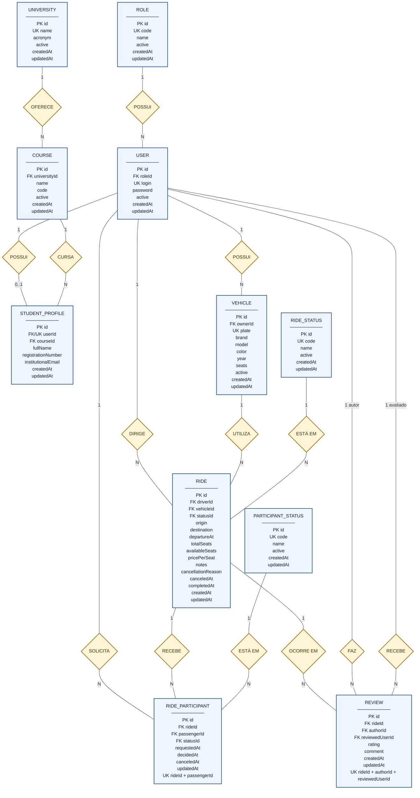

# DER — Carona Universitária (MVP)

Este é um modelo conceitual proposto a partir das regras descritas em
`AGENT.md`. Ele não altera o schema Prisma nem representa uma migration já
aplicada.

## Diagrama de Entidade-Relacionamento

